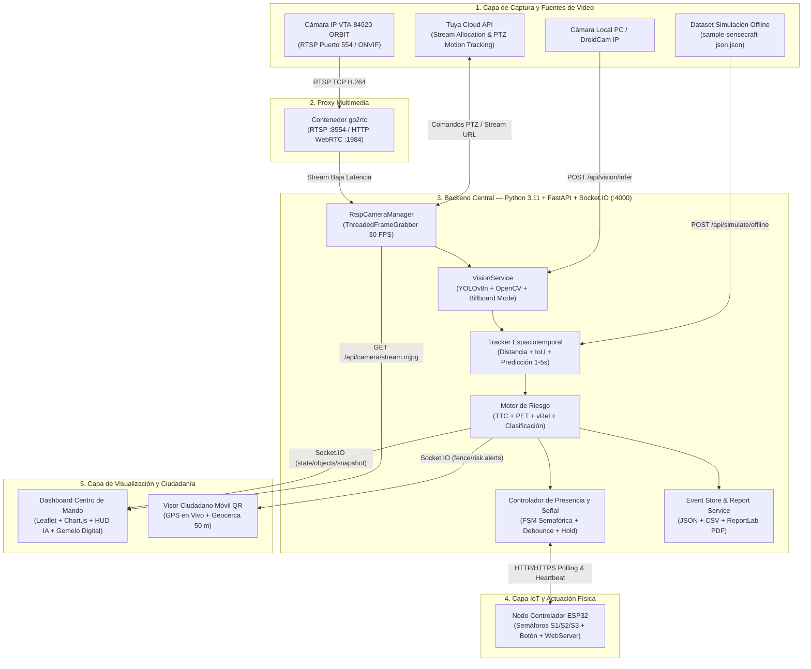

# Especificaciones Técnicas — AI-SafeCrossing (S.I.P.V.A.)

**Plataforma de Seguridad Vial Inteligente: Detección Proactiva de Riesgos, Analítica Cinemática e IoT para la Protección de Actores Viales Vulnerables**

---

## 1. Propósito y Alcance del Sistema

**AI-SafeCrossing (Sistema Inteligente de Protección Vial Activa — S.I.P.V.A.)** es una plataforma tecnológica *edge-to-cloud* diseñada bajo los lineamientos de **Visión Cero** y el enfoque de **Sistema Seguro** de la Agencia Nacional de Seguridad Vial (ANSV). Su objetivo es prevenir siniestros viales en cruces peatonales de alta vulnerabilidad mediante visión por computadora en tiempo real, seguimiento multiobjeto, modelado cinemático predictivo (**TTC**, **PET**, **vRel**), señalización semafórica física gobernada por microcontroladores **ESP32** y alertamiento ciudadano geolocalizado.

---

## 2. Capacidades Funcionales y No Funcionales

### 2.1 Requisitos Funcionales Implementados

1. **Ingesta y Transmisión de Video Multifuente**:
   - **Cámara IP/WiFi VTA-84920 ORBIT (Tuya Smart Life)**: captura continua mediante protocolo **RTSP/ONVIF (puerto 554)** y asignación dinámica de streams desde **Tuya Cloud API (`rtsp`, `flv`, `hls`)**.
   - **Proxy Multimedia de Ultrabaja Latencia (`go2rtc`)**: retransmisión local H.264 sobre TCP (`rtsp://go2rtc:8554/vta_camera` y `http://go2rtc:1984`) para eliminar sobrecarga de conexiones en la cámara física.
   - **Cámara Local (PC WebRTC) y Cámara Móvil IP (DroidCam)**: captura desde navegador o flujo IP local con envío de fotogramas al motor de inferencia central.
   - **Modo Simulación Offline**: reproducción determinista de trazas pregrabadas (`data/sample-sensecraft-json.json`) para validación de algoritmos sin hardware externo.

2. **Inferencia Neuronal y Procesamiento de Visión Computacional**:
   - Ejecución centralizada del modelo **Ultralytics YOLOv8 (`yolov8n.pt`)** con umbral de confianza configurable (`YOLO_CONF = 0.35`) y resolución interna optimizada (`imgsz = 320`) para tiempos de inferencia de **~5 ms**.
   - Arquitectura multihilo desacoplada en Python (`ThreadedFrameGrabber` + `AsyncVisionWorker`) que sostiene **30.0 FPS (intervalo de 33.3 ms)** en el flujo de video en vivo (`POST /api/vision/infer` y `GET /api/camera/stream.mjpg`), dibujando cajas delimitadoras (*hitboxes*) en **0.05 ms**.
   - **Calibración Geométrica Dinámica (`BILLBOARD_MODE`)**: detección automática del polígono cuadrilátero de la zona de cebra mediante umbralización adaptativa gaussiana (`cv2.adaptiveThreshold`), extracción de contornos (`cv2.findContours`) y aproximación poligonal (`cv2.approxPolyDP`).
   - **Seguimiento Motorizado PTZ (`Motion Tracking`)**: integración con **Tuya Cloud API (`tinytuya`)** para activar el giro automático del lente motorizado al detectar actores viales en la escena.

3. **Normalización Taxonómica al Dominio Vial**:
   - Mapeo estandarizado de detecciones hacia 12 clases operativas:
     - Actores vulnerables: `peaton`, `peaton_aereo`, `movimiento_peaton`, `bicicleta`, `ciclista`, `gesto`.
     - Vehículos y transporte público: `motocicleta`, `automovil`, `bus_transcaribe`, `ambulancia`.
     - Infraestructura y contexto: `senal_paso`, `aparcamiento`.

4. **Tracking Espaciotemporal y Predicción Cinemática**:
   - Asociación inter-frame mediante puntaje combinado de **Distancia Euclidiana Normalizada + Intersección sobre Unión ($IoU \times 1.2$)**.
   - Suavizado exponencial de cajas delimitadoras ($\alpha = 0.72$ previo / $0.28$ actual) para estabilidad visual anti-parpadeo (*anti-flicker*).
   - Estimación de vector de velocidad ($\text{px/s}$ y $\text{km/h}$), detección de presencia dentro del polígono de cebra (`inCrosswalk`), orientación convergente hacia el cruce (`headingToCrosswalk`) y proyección lineal de trayectoria de **1 a 5 segundos**.

5. **Motor de Evaluación de Riesgo Multicriterio**:
   - Cálculo en tiempo real de **TTC (Time-to-Collision)**, **PET (Post-Encroachment Time)** y **Velocidad Relativa ($\text{vRel}$)** para cada par peatón-vehículo activo.
   - Clasificación determinista del nivel de riesgo en cuatro estados discretos: **`BAJO`**, **`MEDIO`**, **`ALTO`** y **`CRITICO`**, acompañada de factores explicativos y acción recomendada.

6. **Control Semafórico Físico IoT (ESP32) y Gemelo Digital**:
   - Sincronización bidireccional con controlador **ESP32** dotado de Máquina de Estados Finitos (FSM) para tres grupos semafóricos (**S1 Vehicular Ida**, **S2 Peatonal**, **S3 Vehicular Venida**) y **pulsador peatonal físico** con filtro anti-rebote (`debounce`).
   - Gestión remota de parámetros temporales desde el dashboard: tiempo de vida de solicitud (`requestTtlMs`), anti-rebote (`buttonDebounceMs`), tiempos mínimos de retención (`minHoldGreenMs`, `minHoldRedMs`, `minHoldGrayMs`), *timeout* de latido (`heartbeatTimeoutMs`) y sobreescritura manual (`AUTO`, `GREEN`, `RED`, `GRAY`).
   - Visualización de **Gemelo Digital** en tiempo real y panel embebido directo del servidor web de la ESP32 (`/api/state`, `/api/normal`, `/api/pedestrian`, `/api/set`).

7. **Centro de Mando Web, Cartografía Multicapa y Geocerca Ciudadana**:
   - Dashboard operativo unificado (`frontend/index.html`) organizado en 7 secciones: Resumen & KPIs, Centro de Control, Monitor de Cámara & Telemetría IA, Mapa Geoespacial & Cerca Virtual, Semáforo ESP32 IoT, Analítica de Tráfico y Auditoría de Eventos.
   - Cartografía interactiva en **Leaflet** con capas de vulnerabilidad demográfica por manzanas, siniestralidad histórica DATT Cartagena, mapas de calor (*heatmaps*) de eventos *near-miss* y georreferenciación de objetos mediante `MapAdapter`.
   - **Visor Ciudadano Móvil (`frontend/viewer.html`)**: activación mediante código QR y sincronización multi-dispositivo vía `Socket.IO` de una **cerca virtual de 50 metros** con posicionamiento GPS en tiempo real.

8. **Persistencia, Auditoría y Reportería Institucional**:
   - Almacenamiento automático de conflictos viales de severidad `ALTO` y `CRITICO` en repositorio local estructurado (`data/mock-near-miss-events.json`).
   - Generación de reportes ejecutivos descargables en formato **PDF diario (`ReportLab`)** y **CSV tabular** para autoridades de tránsito (DATT, Secretaría de Movilidad, ANSV).

---

### 2.2 Requisitos No Funcionales

| Atributo de Calidad | Especificación Técnica | Mecanismo de Implementación |
|---|---|---|
| **Latencia y Tiempo Real** | Inferencia IA ~5 ms; stream MJPEG a 30 FPS (33.3 ms); latencia integral < 100 ms | Procesamiento local en el borde (Edge AI), `ThreadedFrameGrabber`, `AsyncVisionWorker` y `go2rtc` |
| **Disponibilidad y Resiliencia** | Operación continua 24/7 con reconexión automática ante caídas de red o cámara | Máquina de estados con modo **FAIL-SAFE**, *watchdog*, *fallback* de streams RTSP y fotograma activo de respaldo |
| **Estabilidad de Señal** | Cero parpadeo en actuadores físicos y overlays visuales | Filtros `debounce` (45 ms HW / 140 ms SW), tiempos mínimos de retención (`minHoldMs`) y suavizado exponencial de *bboxes* |
| **Seguridad en Comunicaciones** | Contexto seguro HTTPS/TLS requerido para APIs de cámara y geolocalización móvil | Certificados TLS autofirmados dinámicos por IP LAN y soporte automatizado de **Cloudflare Tunnels (`trycloudflare.com`)** |
| **Portabilidad y Despliegue** | Ejecución reproducible en cualquier entorno urbano o académico | Orquestación completa en **Docker Compose** (`backend`, `mosquitto`, `go2rtc`) y scripts PowerShell de arranque en 1 paso |

---

## 3. Arquitectura del Sistema y Flujo de Datos

### 3.1 Diagrama de Arquitectura Multicapa



### 3.2 Estructura de Directorios del Proyecto

```text
proyecto-seguridad-vial/
├── arduino/
│   ├── esp32_person_status_web.ino          # Firmware ESP32 sincronizado con Backend HTTPS/HTTP
│   ├── semaforo_web_unificado/              # Firmware ESP32 con servidor web autónomo S1/S2/S3
│   └── test_luces/                          # Rutinas de diagnóstico de hardware LED
├── backend_py/
│   ├── app/
│   │   ├── main.py                          # Servidor FastAPI + Socket.IO + Rutas API y WebSockets
│   │   ├── rtsp_camera.py                   # Gestor RTSP multihilo (30 FPS) + Tuya Cloud + go2rtc
│   │   ├── vision_service.py                # Motor YOLOv8, dibujo de hitboxes y Billboard Mode
│   │   ├── tracker.py                       # Seguimiento multiobjeto y predicción de trayectoria (1-5s)
│   │   ├── prediction.py                    # Cálculo matemático de TTC, PET y conflictos futuros
│   │   ├── risk.py                          # Motor de ponderación y clasificación de severidad vial
│   │   ├── presence_signal.py               # Ventana temporal de presencia peatonal/vehicular
│   │   ├── actor_classes.py                 # Taxonomía de clases del dominio vial
│   │   ├── geometry.py                      # Algoritmos geométricos (point-in-polygon, distancias)
│   │   ├── traffic_counter.py               # Aforo acumulado por clase y cámara
│   │   ├── stats_service.py                 # Agregación estadística por hora, día y semana
│   │   ├── report_service.py                # Exportación de reportes operativos en PDF y CSV
│   │   ├── event_store.py                   # Persistencia de eventos near-miss en JSON
│   │   ├── mqtt_client.py                   # Puente de suscripción MQTT para nodos de borde
│   │   └── models.py                        # Esquemas y contratos de validación Pydantic
│   ├── tools/generate_mock_data.py          # Generador de datos sintéticos de prueba
│   ├── Dockerfile                           # Imagen de contenedor Python 3.11 + OpenCV + YOLO
│   ├── entrypoint.sh                        # Script de inicialización con soporte TLS
│   └── requirements.txt                     # Dependencias del backend
├── certs/                                   # Certificados TLS autofirmados (server.crt, server.key)
├── data/                                    # Capas GeoJSON, historial near-miss y reportes exportados
├── docs/
│   └── ESPECIFICACIONES-TECNICAS.md         # Documentación técnica del sistema
├── frontend/
│   ├── index.html                           # Dashboard principal de Centro de Mando (7 módulos)
│   ├── viewer.html                          # Visor ciudadano móvil con geocerca de 50 m
│   ├── css/tailwind.css                     # Sistema de diseño visual oscuro de alto contraste
│   └── js/
│       ├── app-shell.js                     # Navegación lateral, reloj y controles de interfaz
│       ├── dashboard.js                     # Lógica de cámaras, telemetría, ESP32, QR y gráficas
│       ├── map.js                           # Cartografía Leaflet, coropletas, heatmap y tracks
│       ├── map-adapter.js                   # Transformación afín de píxeles a coordenadas Lat/Lng
│       ├── frame-schema.js                  # Contrato de validación para sobres de objetos
│       └── viewer.js                        # Lógica de geolocalización móvil y alertas de cercanía
├── scripts/
│   ├── start-secure-demo.ps1                # Despliegue automatizado con túnel HTTPS Cloudflare
│   └── test_vta_rtsp.py                     # Utilidad CLI de diagnóstico directo RTSP + YOLOv8
├── docker-compose.yml                       # Orquestación de servicios (backend, mosquitto, go2rtc)
├── go2rtc.yaml                              # Configuración de streams RTSP/FFmpeg de baja latencia
├── start-run.ps1                            # Script de encendido rápido, autodetección IP y QR
├── off-server.ps1                           # Script de apagado limpio de contenedores
└── yolov8n.pt                               # Pesos del modelo neuronal YOLOv8 Nano
```

---

## 4. Stack Tecnológico y Librerías

### 4.1 Backend (`backend_py/requirements.txt`)
- **Python 3.11+**: lenguaje base del servidor de aplicaciones e inteligencia artificial.
- **FastAPI (`0.115.8`) + Uvicorn (`0.34.0`)**: framework web asíncrono de alto rendimiento y servidor ASGI con soporte HTTP/HTTPS.
- **python-socketio (`5.12.1`)**: motor de comunicación bidireccional en tiempo real sobre WebSockets.
- **Ultralytics YOLOv8 (`8.3.0+`)**: red neuronal convolucional de una sola etapa para detección multiclase en tiempo real.
- **OpenCV Headless (`4.10.0.84`) + NumPy (`1.26.4`)**: decodificación de flujos de video RTSP/MJPEG, procesamiento morfológico (`BILLBOARD_MODE`) y trazado vectorial de alta velocidad.
- **TinyTuya + Cryptography**: integración con **Tuya Cloud API** para asignación dinámica de flujos de video y control motorizado **PTZ (`motion_tracking`)**.
- **Pydantic (`2.10.6`)**: validación estricta de esquemas de entrada/salida y contratos de datos.
- **Paho-MQTT (`2.1.0`)**: cliente de mensajería ligera para ingesta desde nodos IoT/Edge.
- **ReportLab (`4.3.1`)**: motor de composición tipográfica para generación de reportes diarios en PDF.

### 4.2 Frontend (`frontend/`)
- **Leaflet (`1.9.4`) + Leaflet.heat**: cartografía web multicapa, polígonos demográficos GeoJSON, marcadores tácticos y mapas de calor.
- **Chart.js**: visualización estadística dinámica de series horarias y distribución modal de vehículos.
- **Socket.IO Client (`4.8.1`)**: recepción asíncrona de estados, telemetría, video anotado, geocerca y estado del hardware ESP32.
- **QRCode.js (`1.0.0`)**: generación dinámica de códigos QR para vinculación inmediata de dispositivos móviles.

### 4.3 Infraestructura e IoT
- **Docker & Docker Compose**: contenedorización de microservicios (`backend`, `eclipse-mosquitto:2`, `alexxit/go2rtc:latest`).
- **ESP32 (Framework Arduino C++)**: librerías `WiFi.h`, `WebServer.h`, `HTTPClient.h`, `WiFiClientSecure.h` y `ESPmDNS.h`.

---

## 5. Motor Cinemático y Lógica de Evaluación de Riesgo

### 5.1 Métricas Cinemáticas Fundamentales
1. **TTC (*Time-to-Collision* — Tiempo hasta la Colisión)**:
   $$\text{TTC} = \frac{d(\vec{p}_{\text{veh}}, \vec{p}_{\text{peat}})}{v_{\text{aprox}}}$$
   Se calcula cuando el producto punto entre el vector posición relativa y el vector velocidad relativa indica convergencia ($\vec{r} \cdot \vec{v}_{\text{rel}} < 0$). Representa los segundos restantes antes del impacto si ambos actores mantienen su velocidad y dirección actuales.
2. **PET (*Post-Encroachment Time* — Tiempo de Invasión Post-Zona)**:
   $$\text{PET} = |t_{\text{peatón en cebra}} - t_{\text{vehículo en cebra}}|$$
   Mide el margen temporal entre el instante en que el primer actor ocupa el polígono del cruce peatonal y el instante en que el segundo actor arriba a la misma zona de conflicto.
3. **Velocidad Relativa ($\text{vRel}$)**:
   $$\text{vRel} = \left| \|\vec{v}_{\text{veh}}\| - \|\vec{v}_{\text{peat}}\| \right|$$

### 5.2 Ponderación Multicriterio (`backend_py/app/risk.py`)
Para cada par $(\text{peatón}, \text{vehículo})$ detectado simultáneamente, el sistema parte de un puntaje base de **10 puntos** y acumula los siguientes factores de riesgo:

| Factor Evaluado | Condición | Puntos Adicionales |
|---|---|---|
| **Presencia en Cebra** | `pedestrian.inCrosswalk == True` | **+25 pts** |
| **Convergencia Vehicular** | `vehicle.headingToCrosswalk == True` | **+20 pts** |
| **Exceso de Velocidad** | `vehicle.speedKmh > 30.0` | **+20 pts** |
| **Prioridad de Emergencia** | `vehicle.className == "ambulancia"` | **+15 pts** |
| **TTC Crítico / Preventivo** | $\text{TTC} < 2.5\text{ s}$ / $2.5\text{ s} \le \text{TTC} < 4.0\text{ s}$ | **+30 pts** / **+15 pts** |
| **PET Crítico / Bajo** | $\text{PET} < 1.5\text{ s}$ / $1.5\text{ s} \le \text{PET} < 3.0\text{ s}$ | **+20 pts** / **+10 pts** |
| **Conflicto Futuro Predicho** | Intersección de trayectorias proyectadas entre 1 y 5 s | **+25 pts** |

### 5.3 Matriz de Clasificación de Severidad y Respuesta

| Nivel de Riesgo | Puntaje Total | Condiciones Típicas de TTC / PET | Respuesta Automática del Sistema |
|---|---|---|---|
| **BAJO** | `< 40 pts` | $\text{TTC} > 4.0\text{ s}$, $\text{PET} > 3.0\text{ s}$ | Monitoreo pasivo continuo; vía libre vehicular (S1/S3 en verde). |
| **MEDIO** | `40 – 64 pts` | $\text{TTC} \in [2.5, 4.0]\text{ s}$, $\text{PET} \in [1.5, 3.0]\text{ s}$ | Pre-alerta preventiva en dashboard y seguimiento activo de trayectorias. |
| **ALTO** | `65 – 89 pts` | $\text{TTC} \in [1.5, 2.5)\text{ s}$ o convergencia directa | Activación de alerta sonora/visual, persistencia de evento *near-miss* y priorización peatonal en ESP32. |
| **CRÍTICO** | `>= 90 pts` | $\text{TTC} < 1.5\text{ s}$, $\text{PET} < 1.5\text{ s}$ o colisión inminente | Alerta multimodal inmediata (LED + alarma + síntesis de voz), bloqueo vehicular en rojo y registro prioritario para auditoría. |

---

## 6. Ecosistema IoT: Controlador Semafórico ESP32 y Máquina de Estados (FSM)

### 6.1 Estados de la Máquina de Estados Finitos (FSM) del Sistema
- **`IDLE` (Reposo Activo)**: monitoreo continuo sin actores en conflicto; tránsito vehicular fluido.
- **`VALIDATING` (Validación Cinemática)**: actor detectado en aproximación; cálculo activo de TTC, PET y proyección de trayectoria.
- **`ACTIVE` (Protección Activa)**: riesgo confirmado o solicitud peatonal activa; conmutación semafórica y emisión de alertas multimodales en $< 100\text{ ms}$.
- **`FAIL-SAFE` (Seguridad ante Fallo)**: ante pérdida de conectividad, fallo de sensor o *timeout* de *heartbeat*, el sistema prioriza la protección de la vida humana activando señalización preventiva de resguardo.

### 6.2 Secuencia de Fases en el Controlador Físico ESP32
El firmware unificado (`semaforo_web_unificado.ino` / `esp32_person_status_web.ino`) gobierna tres grupos de luces (**S1 Vehicular 1**, **S2 Peatonal**, **S3 Vehicular 2**) y un pulsador físico con la siguiente secuencia determinista al activarse un cruce peatonal:

1. **Modo Normal (`IDLE`)**: Vehiculares `S1` y `S3` en **VERDE**; Peatonal `S2` en **ROJO**.
2. **Transición Preventiva (`S1_YELLOW` — 2,000 ms)**: Vehiculares `S1` y `S3` conmutan a **AMARILLO**; Peatonal `S2` permanece en **ROJO**.
3. **Resguardo Total (`S1_RED_WAIT` — 1,000 ms)**: Vehiculares `S1` y `S3` pasan a **ROJO** total antes de habilitar el paso peatonal (intervalo de despeje de seguridad).
4. **Cruce Peatonal Protegido (`S2_GREEN` — 15,000 ms)**: Peatonal `S2` pasa a **VERDE** mientras `S1` y `S3` mantienen **ROJO** absoluto.
5. **Advertencia de Cierre Peatonal (`S2_YELLOW` — 2,000 ms)**: Peatonal `S2` pasa a **AMARILLO** preventivo antes de restituir el Modo Normal.

---

## 7. Contratos de Datos y Especificación de API / WebSockets

### 7.1 Catálogo de Endpoints REST (`FastAPI`)

| Método | Ruta | Descripción Funcional |
|---|---|---|
| `GET` | `/api/health` | Verificación de estado operativo del servicio backend. |
| `POST` | `/api/vision/infer` | Recibe imagen en Base64, ejecuta YOLOv8 + `BILLBOARD_MODE`, actualiza tracking/riesgo y retorna telemetría + imagen anotada. |
| `POST` | `/api/ingest` | Ingesta directa de payloads JSON normalizados desde cámaras o nodos de borde externos. |
| `POST` | `/api/simulate/offline` | Ejecuta el dataset de simulación offline y emite eventos en tiempo real a todos los clientes. |
| `GET` | `/api/camera/stream.mjpg` | Stream de video continuo `multipart/x-mixed-replace` a 30 FPS con cajas delimitadoras dibujadas en vivo. |
| `GET` | `/api/camera/rtsp/status` | Estado detallado de la conexión RTSP (`CONNECTED`, `FPS`, fotogramas procesados, URL activa). |
| `POST` | `/api/camera/rtsp/config` | Actualización en caliente de IP, credenciales RTSP y llaves de Tuya Cloud sin reiniciar el servidor. |
| `POST` | `/api/camera/motion-tracking` | Activa o desactiva el seguimiento motorizado PTZ en la cámara VTA-84920 vía Tuya Cloud API. |
| `GET` | `/api/esp32/person-status` | Endpoint ligero de consulta de estado (`GREEN`, `RED`, `GRAY`) para polling desde el microcontrolador ESP32. |
| `GET` | `/api/esp32/runtime` | Estado consolidado del subsistema ESP32 (`signal`, `connection` online/offline y `config`). |
| `POST` | `/api/esp32/heartbeat` | Recepción de latido periódico desde la placa ESP32 para monitoreo de conectividad. |
| `POST` | `/api/esp32/button` | Registra pulsación del botón peatonal físico con filtro *debounce* y ventana TTL de solicitud activa. |
| `POST` | `/api/esp32/config` | Modifica parámetros de temporización (`TTL`, `debounce`, `minHoldMs`) y modo manual (`AUTO/GREEN/RED/GRAY`). |
| `GET` | `/esp32/light` | Interfaz web ligera auto-refrescable (1 s) con codificación cromática de pantalla completa para monitores auxiliares. |
| `GET` | `/api/events` | Histórico almacenado de eventos de conflicto vial (*near-misses* de severidad ALTA y CRÍTICA). |
| `GET` | `/api/stats` | Métricas agregadas por ventana temporal (`period=hour\|day\|week`), distribución horaria y conteo por severidad. |
| `GET` | `/api/report/traffic` | Reporte de aforo acumulado por clase de actor vial y por cámara activa. |
| `GET` | `/api/export/csv` | Genera y descarga archivo CSV con el registro histórico de eventos *near-miss*. |
| `GET` | `/api/export/pdf` | Genera y descarga el informe ejecutivo diario en formato PDF mediante `ReportLab`. |
| `GET` | `/api/network-qr` | Detecta IPs LAN o túnel HTTPS público (`trycloudflare.com`) y construye la URL primaria para el código QR móvil. |

### 7.2 Eventos en Tiempo Real (`Socket.IO`)

- **`rtsp_frame_update`**: transmite fotogramas anotados en Base64 e indicadores instantáneos desde el hilo de captura RTSP.
- **`state_update`**: resumen ejecutivo de telemetría por ciclo (`cameraId`, `timestamp`, `risk`, `ttc`, `pet`, `vRel`, `objectCount`).
- **`objects_update`**: sobre estandarizado (`schema: "vision-frame/v1"`) con la lista de objetos rastreados, coordenadas geográficas (`latLng`), trayectorias predichas (`predicted`), estelas (`trail`), polígono de cebra (`crosswalk`) y eventos especiales.
- **`snapshot`**: instantánea integral con conteos por clase y detalle completo del evento de riesgo activo.
- **`esp32_runtime_update` / `esp32_signal_update` / `esp32_config_update`**: sincronización en vivo del gemelo digital del semáforo ESP32.
- **`fence_update`**: activación, posición GPS y expiración de la cerca virtual de 50 metros entre el visor móvil y el centro de mando.
- **`devices_update` / `device_hello` / `location_update`**: gestión en tiempo real de clientes conectados (dashboards y visores ciudadanos).

### 7.3 Contrato de Datos: `objects_update` (`vision-frame/v1`)

```json
{
  "schema": "vision-frame/v1",
  "cameraId": "cam-vta-rtsp",
  "timestamp": "2026-10-16T16:50:00.000Z",
  "state": {
    "risk": "ALTO",
    "ttc": 2.14,
    "pet": 1.48,
    "vRel": 132.7
  },
  "objects": [
    {
      "id": "T0007",
      "classType": "peaton",
      "score": 0.93,
      "center": { "x": 640, "y": 340 },
      "latLng": { "lat": 10.4239, "lng": -75.5454 },
      "bbox": { "x": 610, "y": 240, "w": 60, "h": 160 },
      "predicted": { "x": 652, "y": 341 },
      "trail": [
        { "x": 615, "y": 338 },
        { "x": 628, "y": 339 }
      ]
    }
  ],
  "events": [
    {
      "type": "bus_transcaribe",
      "label": "bus_transcaribe detectado",
      "trackId": "T0002",
      "at": "2026-10-16T16:50:00.000Z"
    }
  ],
  "crosswalk": [
    { "x": 435.2, "y": 381.6 },
    { "x": 844.8, "y": 381.6 },
    { "x": 947.2, "y": 648.0 },
    { "x": 332.8, "y": 648.0 }
  ]
}
```

---

## 8. Parámetros de Configuración y Despliegue Operativo

### 8.1 Variables de Entorno Principales (`docker-compose.yml`)

| Variable | Valor por Defecto | Función |
|---|---|---|
| `PORT` | `4000` | Puerto HTTPS/HTTP del servidor FastAPI + Socket.IO. |
| `LAN_IP` | Autodetectada por `start-run.ps1` | Dirección IPv4 local para certificados TLS, QR y comunicación ESP32. |
| `YOLO_MODEL_PATH` | `yolov8n.pt` | Ruta del archivo de pesos neuronales YOLOv8. |
| `YOLO_CONF` | `0.35` | Umbral mínimo de confianza para aceptar detecciones. |
| `BILLBOARD_MODE` | `true` | Activa la calibración dinámica del polígono de paso peatonal por visión clásica. |
| `RTSP_CAMERA_ENABLE` | `true` | Habilita el hilo de ingesta automática RTSP al iniciar el backend. |
| `RTSP_CAMERA_IP` | `192.168.1.76` | Dirección IP local de la cámara VTA-84920 ORBIT. |
| `RTSP_CAMERA_URL` | `rtsp://go2rtc:8554/vta_camera` | URL del puente proxy `go2rtc` de baja latencia. |
| `TUYA_CLIENT_ID` / `SECRET` / `DEVICE_ID` | Preconfigurados | Credenciales de Tuya Cloud para asignación de stream y control PTZ. |
| `USE_MQTT` / `MQTT_BROKER_URL` | `false` / `mqtt://mosquitto:1883` | Configuración del broker Eclipse Mosquitto para nodos MQTT adicionales. |

### 8.2 Procedimiento de Puesta en Marcha

1. **Despliegue Automatizado Local (Docker + Autodetección IP + QR)**:
   ```powershell
   .\start-run.ps1
   ```
2. **Despliegue con Túnel Público HTTPS (Cloudflare Tunnel para GPS Móvil)**:
   ```powershell
   powershell -ExecutionPolicy Bypass -File .\scripts\start-secure-demo.ps1 -OpenBrowser
   ```
3. **Apagado Seguro de Servicios**:
   ```powershell
   .\off-server.ps1
   ```
